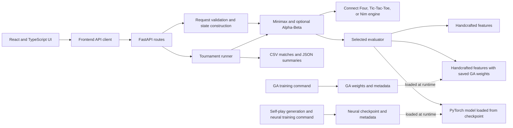

# GameMind

GameMind is a full-stack game-search and evaluator-comparison project for studying how handcrafted, genetic-algorithm-tuned, and neural position evaluators affect game-tree search.

The primary research environment is Connect Four. The application also includes Tic-Tac-Toe and Nim engines, a FastAPI backend, a React interface, reproducible training scripts, and a tournament runner that writes raw and aggregate experiment records.

**Highlights**

- Connect Four state validation, legal moves, four-direction win detection, draw detection, and winning-cell reporting.
- Depth-limited Minimax with optional Alpha-Beta pruning, iterative deepening, node/time limits, and search statistics.
- Three Connect Four evaluators: a handcrafted weighted score, saved GA-tuned weights, and a saved PyTorch value model.
- Seeded training and paired evaluator tournaments with CSV/JSON output and artifact fingerprints.

## Table of contents

- [Overview](#overview)
- [Features](#features)
- [Architecture](#architecture)
- [Technology stack](#technology-stack)
- [Repository structure](#repository-structure)
- [Installation](#installation)
- [Run the application](#run-the-application)
- [Search and evaluators](#search-and-evaluators)
- [Training methodology](#training-methodology)
- [Experiments and results](#experiments-and-results)
- [Tests and verification](#tests-and-verification)
- [Saved artifacts and reproducibility](#saved-artifacts-and-reproducibility)
- [HTTP API](#http-api)
- [Troubleshooting](#troubleshooting)
- [Limitations and future work](#limitations-and-future-work)
- [Quick reference](#quick-reference)

## Overview

GameMind provides a place to inspect game-search behavior and compare position evaluators under shared game rules and search settings. Game-tree search repeatedly considers legal continuations. A position evaluator assigns a value to a nonterminal position at the depth boundary; changing that evaluator can change the selected move even when the search algorithm and budget remain the same.

Connect Four is the main experimental environment because it has a compact state, tactical wins and blocks, and enough branching to make depth-limited search and evaluator quality relevant. Tic-Tac-Toe is a small search environment; the UI searches to depth 9 for optimal play. Nim offers a direct XOR-based optimal move and a Minimax strategy for comparison.

The evaluators have different roles. The handcrafted evaluator provides an interpretable weighted feature score. The GA script searches for alternative weights using a one-ply tactical proxy. The neural evaluator loads a saved PyTorch model trained on self-play outcome labels. Tournament outcomes are empirical measurements for the configured search budget and opponents; they are not proof of general playing strength.

## Features

| Area | Implemented functionality |
| --- | --- |
| Game engines | Connect Four, Tic-Tac-Toe, and Nim; legal moves and terminal-state handling are implemented in the backend. |
| Search | Depth-limited Minimax, optional Alpha-Beta pruning, iterative deepening, centre-first Connect Four move ordering, and node/time limits. |
| Evaluators | Handcrafted Connect Four features, saved GA-tuned feature weights, and a saved neural value model. Nim also supports an XOR optimal evaluator. |
| Training | Seeded GA weight optimization and heuristic-guided Connect Four self-play data generation followed by PyTorch training. |
| Experiments | Configurable round-robin evaluator matches, alternating seats in pairs, five legal opening lines, CSV raw records, JSON summaries, and artifact hashes. |
| API and UI | FastAPI endpoints for health, search, tournaments, and experiment history; a React/TypeScript client built with Vite, human-vs-AI play, and stepwise AI-vs-AI play. |
| Verification | Backend pytest suite and frontend Vitest test; TypeScript compilation and Vite production build. |

## Architecture

The UI calls the API for moves and experiment operations. The backend validates requests, constructs the selected game state, and invokes search or the tournament runner. Runtime inference loads saved model artifacts; training is performed separately by command-line scripts and is not triggered during ordinary gameplay.



## Technology stack

| Technology | Role in the repository |
| --- | --- |
| Python 3.10+ | Game rules, request handling, search, training, and experiments. |
| FastAPI and Pydantic | HTTP API and request validation. Uvicorn serves the API during development. |
| NumPy and PyTorch | Neural input encoding, model training, and CPU inference. |
| pytest and HTTPX | Backend tests and HTTP test-client support. |
| TypeScript and React | Frontend application and API client. |
| Vite | Frontend development server and production build. |
| Vitest | Frontend test runner for the existing API-client test. |
| Recharts | Frontend chart components. |

Python dependency minimums are declared in [`backend/requirements.txt`](backend/requirements.txt) and [`backend/pyproject.toml`](backend/pyproject.toml). Frontend versions are locked in [`frontend/package-lock.json`](frontend/package-lock.json); `frontend/package.json` declares the scripts and direct dependencies. A specific Node.js version is not declared by the project.

## Repository structure

```text
GameMind/
├── README.md
├── backend/
│   ├── app/
│   │   ├── evaluators/       # Handcrafted features and neural model
│   │   ├── experiments/      # Tournament runner and output writing
│   │   ├── games/            # Connect Four, Tic-Tac-Toe, and Nim
│   │   ├── search/           # Minimax / Alpha-Beta search
│   │   ├── training/         # GA and neural training entry points
│   │   ├── main.py           # FastAPI application and routes
│   │   └── paths.py          # Model and data directories
│   ├── data/                 # Raw experiment CSVs and JSON summaries
│   ├── models/               # Saved neural and GA artifacts
│   ├── tests/                # Backend unit and HTTP integration tests
│   ├── pyproject.toml
│   └── requirements.txt
└── frontend/
    ├── src/                  # React UI, API client, and frontend tests
    ├── package.json
    └── package-lock.json
```

Important files include [`connect_four.py`](backend/app/games/connect_four.py), [`minimax.py`](backend/app/search/minimax.py), [`heuristic.py`](backend/app/evaluators/heuristic.py), [`neural.py`](backend/app/evaluators/neural.py), [`train_genetic.py`](backend/app/training/train_genetic.py), [`train_connect4.py`](backend/app/training/train_connect4.py), [`tournament.py`](backend/app/experiments/tournament.py), and [`test_core.py`](backend/tests/test_core.py).

## Installation

### Prerequisites

- Python 3.10 or newer. The project metadata declares `requires-python = ">=3.10"`.
- Node.js and npm. The repository does not declare a minimum Node.js version.
- PowerShell instructions below are written for Windows. The frontend lockfile supports `npm ci` for repeatable dependency installation.

Extract the project archive or clone the repository, then open a terminal at the repository root.

### Backend environment (Windows PowerShell)

```powershell
cd backend
python -m venv .venv
.\.venv\Scripts\Activate.ps1
python -m pip install -r requirements.txt
```

If PowerShell does not permit activation, use the virtual environment's interpreter directly:

```powershell
.\.venv\Scripts\python.exe -m pip install -r requirements.txt
.\.venv\Scripts\python.exe -m uvicorn app.main:app --reload
```

### Frontend dependencies

Open a second terminal at the repository root:

```powershell
cd frontend
npm ci
```

The frontend uses `VITE_API_URL` to select the backend base URL. The default is `http://localhost:8000`. An example file is provided at [`frontend/.env.example`](frontend/.env.example). To override it locally, create `frontend/.env.local` with, for example:

```dotenv
VITE_API_URL=http://localhost:8000
```

Vite reads this variable when the frontend development server starts.

## Run the application

Start the backend in terminal 1 from the repository root:

```powershell
cd backend
.\.venv\Scripts\Activate.ps1
python -m uvicorn app.main:app --reload
```

Start the frontend in terminal 2 from the repository root:

```powershell
cd frontend
npm run dev
```

Open the Vite URL printed in terminal 2, normally `http://localhost:5173`. The API listens on `http://localhost:8000` by default.

Check backend health from another PowerShell terminal:

```powershell
Invoke-RestMethod http://localhost:8000/api/health
```

The successful response reports `status: ok`, the supported games, and available evaluators. Interactive API documentation is available at `http://localhost:8000/docs` through FastAPI's default documentation route.

## Search and evaluators

### Minimax

Search evaluates a tree of legal moves to a depth limit. Red is player `1` and is the maximizing player; Yellow is player `-1` and is the minimizing player. Values are expressed from Red's perspective. When a win is found, search returns `(100000 - ply) * winner`, preferring quicker Red wins and slower Red losses. A draw scores `0`. At the depth boundary, the selected evaluator scores the position.

The search routine uses iterative deepening by default, preserving a move from the last fully completed depth. `SearchResult` reports a move, value, recursively visited node count, elapsed time, completed depth, root candidate scores, and number of pruned branches. The root move loop itself is not counted as a recursive search node.

### Alpha-Beta pruning

Alpha-Beta tracks the best lower bound (`alpha`) for the maximizing side and upper bound (`beta`) for the minimizing side. A branch is cut when `alpha >= beta`. With the same state, depth, move ordering, and evaluator, pruning preserves the Minimax value while potentially reducing visited nodes. Connect Four uses centre-first move ordering. Node and time limits apply to each search call; the tournament runner starts a new search budget on each move. Time limits are soft because they are checked during recursive search rather than enforced by a hard process deadline.

### Handcrafted evaluator

The handcrafted Connect Four score is a Red-perspective weighted sum of:

- Red-minus-Yellow occupancy of the centre column.
- Unblocked four-cell windows containing one, two, or three pieces for either side.
- Gravity-valid immediate winning drops available to either color.

Default feature weights are defined in [`heuristic.py`](backend/app/evaluators/heuristic.py). Search itself handles terminal win/draw scores before calling an evaluator at a leaf.

### Genetic-algorithm evaluator

The chromosome is a set of five weights: `center`, `open1`, `open2`, `open3`, and `threats`. The default optimizer uses 20 candidates for 8 generations with seed 7. It keeps two elite candidates, selects parents from the top half of the ranked population, uses uniform per-feature crossover, and with probability 0.25 mutates one feature by adding a Gaussian perturbation (standard deviation 2, with a 0.01 lower bound).

The fitness is a **one-ply tactical proxy**: it chooses a candidate successor using the candidate weights, then scores that successor using fixed opponent weight profiles from the candidate mover's perspective. It does not simulate the opponent's reply or score a completed game. The saved weights are in [`genetic_weights.json`](backend/models/genetic_weights.json); [`genetic_experiment.json`](backend/models/genetic_experiment.json) records configuration and a separate held-out matchup. That matchup is small and does not convert the proxy into a general strength measure.

### Neural evaluator

The network input has two 6×7 planes: pieces belonging to the side to move and pieces belonging to its opponent. Training and inference use the same `encode()` function. The model is an 84-128-64-1 multilayer perceptron with ReLU hidden layers and a tanh output. Inference returns a side-to-move value in `[-1, 1]`, scaled to `[-100, 100]`; the API and tournament multiply it by `state.turn` to obtain the Red-perspective search value.

Training targets are **realized outcomes from completed heuristic-guided self-play games**, not exact game-theoretic values. A saved target is `winner * side_to_move`: `+1` for a realized win, `-1` for a realized loss, and `0` for a draw. The neural checkpoint is [`connect4.pt`](backend/models/connect4.pt); its metadata is [`connect4.json`](backend/models/connect4.json). Runtime inference loads the checkpoint and evaluates leaves inside search when the neural evaluator is selected.

## Training methodology

Run training commands from `backend`:

```powershell
python -m app.training.train_genetic
python -m app.training.train_connect4
```

The GA command uses the seeds and population/generation configuration recorded in its experiment metadata. The Connect Four generator creates 100 completed heuristic-guided self-play games (greedy move probability 0.7, random legal move probability 0.3, generation seed 21), labels every visited position by the final game outcome, and passes the generated positions directly to training in memory. In the saved run, the games produced 1,545 positions; global exact/mirror deduplication removed 565 and retained 980. Eleven source-game groups had no positions remaining after deduplication. The 89 retained groups split into 62/13/14 train/validation/test games, representing 682/129/169 positions. It does not write a separate dataset file.

Before splitting, training globally deduplicates exact and horizontally mirrored board encodings. It then assigns whole source-game groups to train/validation/test with an approximate 70/15/15 group split, using split seed 11. This prevents the same source game from appearing across splits and prevents exact horizontal mirrors from crossing splits. The fixed 30-epoch training run uses MSE loss and Adam at 0.001; the current implementation does not use validation early stopping or select the checkpoint by validation score. The final checkpoint and JSON metadata are written to `backend/models/` and overwritten by retraining.

## Experiments and results

The tournament runner compares every pair of available evaluators. Its `matches` argument is the number of games per evaluator pairing. It alternates which evaluator is assigned the first seat for paired games on the same opening. The opening schedule shuffles five legal opening lines with the supplied seed and cycles through them; odd match counts do not guarantee perfectly balanced seats.

Node-budget and time-budget experiments are separate configurations. The node or time limit is applied per move, while records also report actual per-game totals and maximum measurements per move. Time limits are soft and may overshoot. CSV files contain raw match records; JSON summaries contain configurations, aggregate results, limitations, and hashes of the saved neural and GA artifacts. The aggregate convention below is **wins-A / draws / wins-B**.

### Larger equal-node sample

The latest larger run used seed `20261027`, depth cap 6, and 20 nodes per move. It contains 30 games per evaluator pair (90 total), with 15 games in each first-seat assignment per pair. Five openings were used, each for three paired seat swaps.

| Evaluator A | Evaluator B | Wins-A | Draws | Wins-B | Games | A first | B first |
| --- | --- | ---: | ---: | ---: | ---: | ---: | ---: |
| Handcrafted | Genetic | 12 | 0 | 18 | 30 | 15 | 15 |
| Handcrafted | Neural | 30 | 0 | 0 | 30 | 15 | 15 |
| Genetic | Neural | 30 | 0 | 0 | 30 | 15 | 15 |

The raw data is [`matches-20261011T191818130789Z.csv`](backend/data/matches-20261011T191818130789Z.csv), and its fingerprinted aggregate is [`summary-20261011T191818130789Z.json`](backend/data/summary-20261011T191818130789Z.json). These deterministic results describe this particular low node budget, opening pool, and evaluator configuration. They are not a general playing-strength ranking and have no uncertainty estimate.

### Historical equal-time sample

The retained 50 ms-per-move run used depth cap 6 and recorded 10 games per pairing. These older records are explicitly labeled legacy because they lack the current artifact fingerprints and per-move maximum fields.

| Evaluator A | Evaluator B | Wins-A | Draws | Wins-B | Games | A first | B first |
| --- | --- | ---: | ---: | ---: | ---: | ---: | ---: |
| Handcrafted | Genetic | 4 | 0 | 6 | 10 | 5 | 5 |
| Handcrafted | Neural | 6 | 1 | 3 | 10 | 5 | 5 |
| Genetic | Neural | 5 | 0 | 5 | 10 | 5 | 5 |

The largest recorded per-move elapsed time was 73.564 ms under the requested 50 ms limit. This confirms the time budget is soft; it is not a strict wall-clock cap. The raw records are [`matches-20261011T174128535902Z.csv`](backend/data/matches-20261011T174128535902Z.csv) with aggregate [`summary-20261011T174128535902Z.json`](backend/data/summary-20261011T174128535902Z.json).

### Neural held-out metrics

The saved checkpoint metadata reports these MSE values:

| Split | Neural model | Training-mean baseline | Handcrafted sign baseline |
| --- | ---: | ---: | ---: |
| Train | 0.6397 | — | 1.5337 |
| Validation | 1.0152 | 0.9947 | 1.6977 |
| Test | 0.9794 | 0.9983 | 0.9704 |

Validation MSE is worse than the training-mean baseline. Test MSE is only slightly better than the mean baseline and is worse than the handcrafted sign baseline. These data do not support a claim of robust neural generalization.

### GA held-out matchup

The separate saved held-out depth-1 matchup against default handcrafted weights recorded **5 wins, 0 draws, and 3 losses** over 8 games from four held-out reachable states. It measures the saved configuration against one opponent on a small deterministic position set; it is not a general tournament estimate and is distinct from the one-ply training proxy.

### Smoke and historical runs

Smaller node-budget runs are useful as experiment-pipeline smoke tests. Historical time-budget records are retained in `backend/data/`; older records are marked `legacy_unfingerprinted` when they do not contain current artifact hashes and per-move maxima. They should not be conflated with the larger equal-node run above. The runner stores actual measurements rather than synthesizing outcomes.

## Tests and verification

From `backend`, run:

```powershell
python -m pytest tests -q
```

From `frontend`, run:

```powershell
npm test -- --run
npm run build
```

The latest recorded verification is 22 passing backend tests, 1 passing frontend test, and a successful production build. Backend coverage includes Connect Four win directions and draws, full-column/legal-move behavior, immutable search transitions, tactical wins and blocks, Yellow root-turn handling, seeded Minimax/Alpha-Beta value comparisons, node limits, evaluator invocation, saved-artifact metadata, tournament record consistency, and lifespan-managed FastAPI route tests. This is focused regression coverage, not a proof of complete correctness.

The Vite production build currently emits a bundle-size warning for a minified JavaScript chunk larger than 500 kB. The build succeeds; the warning is not a test failure.

## Saved artifacts and reproducibility

| Artifact | Path | Purpose |
| --- | --- | --- |
| Neural checkpoint | `backend/models/connect4.pt` | PyTorch state dictionary used for neural inference. |
| Neural metadata | `backend/models/connect4.json` | Dataset accounting, model configuration, metrics, and checkpoint hash. |
| GA weights | `backend/models/genetic_weights.json` | Five weights used by the genetic evaluator. |
| GA metadata | `backend/models/genetic_experiment.json` | Fitness definition, seed/configuration, history, and held-out matchup. |
| Experiment data | `backend/data/matches-*.csv`, `backend/data/summary-*.json` | Raw games and aggregate/configuration records. |

Saved model artifacts are required to run the corresponding evaluators without retraining. Training source is included; the neural positions are generated deterministically in memory by `train_connect4.py`, not stored as a separate dataset. Tournament seeds and artifact fingerprints are recorded, but results should not be assumed bit-for-bit reproducible across different dependency versions or execution environments.

## HTTP API

The API is served by FastAPI at `http://localhost:8000` by default. Pydantic validates request fields; invalid request bodies generally return HTTP 422.

| Method and path | Purpose |
| --- | --- |
| `GET /api/health` | Returns status plus supported game and evaluator names. |
| `POST /api/search` | Validates a game state, selects an evaluator, and returns one search move and measurements. |
| `POST /api/experiments/tournament` | Runs a configured tournament and returns its summary. |
| `GET /api/experiments/history` | Returns saved JSON summaries from the backend data directory. |

### Search request

Common request fields are `game` (`connect4`, `tictactoe`, or `nim`), `turn` (`1` or `-1`, default `1`), `depth` (1–12, default `4`), and `evaluator` (`handcrafted`, `genetic`, `neural`, or `optimal`, default `handcrafted`). Connect Four uses the handcrafted, genetic, or neural evaluator; Nim uses its optimal XOR strategy or Minimax; Tic-Tac-Toe uses its built-in positional evaluator with search. Supply a 6×7 `board` for Connect Four, nine `cells` for Tic-Tac-Toe, or 1–10 `piles` (each 0–50) for Nim. Optional `time_limit_ms` is 1–60,000; `node_limit` is 1–10,000,000; `alpha_beta` defaults to `true`.

Example request for an empty Connect Four board:

```json
{
  "game": "connect4",
  "depth": 4,
  "evaluator": "handcrafted"
}
```

When no board is supplied, the backend constructs an empty board. A successful response contains `move`, `value`, `nodes`, `elapsed_ms`, `completed_depth`, `candidate_scores`, `pruned`, `evaluator`, and `game`. Invalid board dimensions, cell values, gravity, or side-to-move counts return 422. Already-terminal states return 400. Selecting neural or genetic evaluation for Connect Four without its required saved artifact returns 503.

### Tournament request

Fields are `matches` (1–1,000, default 20), `depth` (1–8, default 3), `seed` (default 13), `budget` (`depth`, `time`, or `nodes`, default `depth`), and optional `budget_value` (1–10,000,000). Node/time modes require `budget_value`; budget modes cannot be combined in one request. A successful response is the JSON summary described above, including raw result records and aggregate counts.

Example one-game-per-pair node-budget request:

```json
{
  "matches": 2,
  "depth": 6,
  "seed": 20261027,
  "budget": "nodes",
  "budget_value": 20
}
```

## Troubleshooting

| Symptom | Check |
| --- | --- |
| `python` or dependency installation fails | Confirm Python 3.10+ is installed, activate the backend virtual environment, and install `backend/requirements.txt`. |
| PowerShell blocks virtual-environment activation | Use `backend/.venv/Scripts/python.exe` directly, or activate the environment according to local PowerShell policy. |
| `npm ci` fails | Confirm Node.js/npm are installed and run the command from `frontend/`, where `package-lock.json` is located. |
| Frontend cannot reach the API | Start Uvicorn, check `http://localhost:8000/api/health`, and verify `VITE_API_URL` in `frontend/.env.local`. Restart Vite after changing the variable. |
| Address already in use | Stop the process using port 8000 or 5173; Uvicorn and Vite can be configured to use other ports, then update `VITE_API_URL` for the API address. |
| Neural or genetic request returns 503 | Check that the corresponding checkpoint/weights exist under `backend/models/`; use the training commands below to regenerate them if intended. |
| Tournament command cannot find the application package | Run it from `backend/` so `app` is importable and paths resolve to `backend/data/` and `backend/models/`. |

## Limitations and future work

### Current limitations

- Neural labels are realized self-play outcomes, not exact solver or game-theoretic values.
- The neural validation result is worse than its training-mean baseline; its test result is only slightly better than that baseline and worse than the handcrafted sign baseline.
- GA training uses a one-ply tactical proxy without opponent replies or completed-game outcomes.
- Tournament samples use a small fixed opening pool and particular evaluator/search configurations. The 90-game sample is descriptive and cannot establish broad or universal superiority.
- Time budgets are soft and can overshoot while search checks elapsed time between nodes.
- Dependency ranges are not all pinned in the backend requirements; cross-environment bit-for-bit reproducibility is not guaranteed.

### Possible future work

- Generate broader position data and compare outcome labels with stronger search-derived or solver labels.
- Improve model selection and evaluate on larger, independently sampled position sets.
- Expand opening generation and tournament sample sizes; report uncertainty when the evaluation design supports it.
- Pin backend dependency versions and document tested runtime versions.

## Quick reference

Commands below use Windows PowerShell from the repository root unless a directory change is shown.

| Task | Commands |
| --- | --- |
| Backend setup | `cd backend` → `python -m venv .venv` → `.\.venv\Scripts\Activate.ps1` → `python -m pip install -r requirements.txt` |
| Frontend setup | `cd frontend` → `npm ci` |
| Start backend | From `backend/`: `python -m uvicorn app.main:app --reload` |
| Start frontend | From `frontend/`: `npm run dev` |
| Check health | `Invoke-RestMethod http://localhost:8000/api/health` |
| Backend tests | From `backend/`: `python -m pytest tests -q` |
| Frontend tests | From `frontend/`: `npm test -- --run` |
| Production build | From `frontend/`: `npm run build` |
| Train GA weights | From `backend/`: `python -m app.training.train_genetic` |
| Train neural checkpoint | From `backend/`: `python -m app.training.train_connect4` |
| Equal-node experiment | From `backend/`: `python -c "from app.experiments.tournament import run_tournament; print(run_tournament(matches=30, depth=6, budget_nodes=20, seed=20261027))"` |
| Equal-time experiment | From `backend/`: `python -c "from app.experiments.tournament import run_tournament; print(run_tournament(matches=10, depth=6, time_limit_ms=50, seed=20261028))"` |
| Locate experiment output | `backend/data/matches-*.csv` and `backend/data/summary-*.json` |
